# Evaluación Parcial N°3 — Observabilidad y entornos reales en DevOps

**Asignatura:** DOY0101 — Ingeniería DevOps  
**Carrera:** Ingeniería en Informática, mención Inteligencia Artificial  
**Sección:** INGENIERIA DEVOPS_003D_OLS  
**Docente:** Rodrigo Seguel  
**Integrantes:**

- Diego Hernández — d.hernandez3@duocuc.cl
- Sebastián Escobar — se.escobarn@duocuc.cl

**Fecha de entrega:** 24/11/2026  
**Repositorios:**

- [Model-Training-S3](https://github.com/Sebithaz-dev/Model-Training-S3)
- [CitiBike-Infra](https://github.com/Sebithaz-dev/CitiBike-Infra)
- [Flask-Dashboard-S3](https://github.com/Sebithaz-dev/Flask-Dashboard-S3)

**Entorno de demostración:** AWS Learner Lab, cuenta `690247773624`, región `us-east-1`.
Sesión documentada: **2026-11-23** (auditoría completa de cumplimiento: 2026-11-19). La URL del balanceador cambia si se recrea la
infraestructura; se obtiene con:

```bash
terraform -chdir=terraform output -raw dashboard_url
```

---

## Declaración de uso de inteligencia artificial

| Herramienta | Para qué se usó | Dónde se aplicó | Cómo se validó |
|---|---|---|---|
| Claude (Anthropic), asistente de IA generativa | Revisar la pauta contra el estado de los repositorios y proponer las brechas a cubrir | Lista de pendientes previa a esta entrega | El equipo contrastó cada brecha con la pauta y con el código |
| Claude (Anthropic) | Estructura de este informe, tablas de evidencia y redacción de las secciones descriptivas | Secciones 1 a 9 y anexos | Cada dato se contrastó con la evidencia de `CitiBike-Infra/docs/evidence/` y con los repositorios |
| Claude Code (Anthropic) | Aplicar los cambios en ramas, validarlos y abrir los pull requests | PR #17 (CitiBike-Infra), #26 (Flask-Dashboard-S3), #30 (Model-Training-S3) | Revisión de cada PR por el equipo antes del merge |

Referencia: Anthropic. (2026). *Claude* [Modelo de lenguaje de gran tamaño].
https://claude.ai

---

## Resumen ejecutivo

Esta entrega extiende el pipeline DevOps del proyecto Citi Bike NYC, que
clasifica viajes en cortos o largos, con observabilidad, despliegue en la nube y
políticas de cumplimiento automatizadas.

El dashboard Flask corre en **AWS ECS on EC2**, creado con Terraform, detrás de
un balanceador de carga y junto a Prometheus, Grafana, Alertmanager y Blackbox
Exporter: cinco servicios orquestados en el Learner Lab. Cada push a `main`
que pasa las pruebas despliega automáticamente la imagen del commit en ECS y
publica la duración del despliegue en CloudWatch.

La observabilidad combina métricas de aplicación en Prometheus, métricas de
infraestructura y del pipeline en CloudWatch y logs JSON en CloudWatch Logs,
todo visible en un dashboard de Grafana de cinco filas: disponibilidad, errores
y latencia, recursos, CI/CD y modelo, y logs. Ocho alarmas de CloudWatch y seis
reglas de Prometheus vigilan disponibilidad, errores, latencia, recursos, quality
gates y despliegues, con aviso por correo vía SNS.

El cumplimiento se aplica con branch protection en los tres repositorios,
SonarCloud, Snyk, Dependabot, secret scanning y un script de auditoría que
verificó 47 controles sin fallas. Los gates detienen el pipeline ante tests
rotos, cobertura bajo el mínimo, vulnerabilidades altas, deuda de calidad,
infraestructura inválida o un modelo bajo sus umbrales; se demostró con un pull
request que quedó bloqueado.

### Resultados principales de la sesión verificada

| Resultado | Valor observado | Evidencia |
|---|---|---|
| Servicios ECS en ejecución | 5/5 en `1/1` y `COMPLETED` | [`ecs-services.txt`](https://github.com/Sebithaz-dev/CitiBike-Infra/blob/main/docs/evidence/20261123T003653Z/ecs-services.txt) |
| Target groups del ALB | 2/2 `healthy` | [`target-group-dashboard.txt`](https://github.com/Sebithaz-dev/CitiBike-Infra/blob/main/docs/evidence/20261123T003653Z/target-group-dashboard.txt), [`target-group-grafana.txt`](https://github.com/Sebithaz-dev/CitiBike-Infra/blob/main/docs/evidence/20261123T003653Z/target-group-grafana.txt) |
| Endpoints del dashboard | `/health`, `/`, `/metrics` → 200 | [`http-status.txt`](https://github.com/Sebithaz-dev/CitiBike-Infra/blob/main/docs/evidence/20261123T003653Z/http-status.txt) |
| Targets de Prometheus | 5/5 con `up=1` | [`prometheus-up.txt`](https://github.com/Sebithaz-dev/CitiBike-Infra/blob/main/docs/evidence/20261123T003653Z/prometheus-up.txt) |
| Alarmas de CloudWatch | 8/8 en `OK` | [`cloudwatch-alarms.txt`](https://github.com/Sebithaz-dev/CitiBike-Infra/blob/main/docs/evidence/20261123T003653Z/cloudwatch-alarms.txt) |
| Cobertura de tests | Flask-Dashboard-S3 83,61 % (29 tests); Model-Training-S3 90,07 % (63 tests) | [`cloudwatch-cicd-values.txt`](https://github.com/Sebithaz-dev/CitiBike-Infra/blob/main/docs/evidence/20261123T003653Z/cloudwatch-cicd-values.txt) |
| Duración de un despliegue | 138 s (job `deploy-ecs`) y 142 s (`deploy.sh`), `DeploymentSucceeded=1` | [`cloudwatch-cicd-values.txt`](https://github.com/Sebithaz-dev/CitiBike-Infra/blob/main/docs/evidence/20261123T003653Z/cloudwatch-cicd-values.txt) |
| Auditoría de cumplimiento | 47 controles, 0 fallas, 0 no evaluables | [`compliance.txt`](https://github.com/Sebithaz-dev/CitiBike-Infra/blob/main/docs/evidence/20261119T183438Z/compliance.txt) |
| Gate bloqueante demostrado | PR #28 (tests) y PR #27 (Snyk) en `BLOCKED` | [`ie6-gate-bloqueante.txt`](https://github.com/Sebithaz-dev/CitiBike-Infra/blob/main/docs/evidence/20261123T003653Z/ie6-gate-bloqueante.txt) |
| Modelo en producción | ROC-AUC 0,6505; F1 0,4650; test 94.686 | [`README.md` — últimas métricas](https://github.com/Sebithaz-dev/Model-Training-S3/blob/main/README.md#últimas-métricas-test-temporal) |

---

## Índice

| Sección | Contenido |
|---|---|
| 1 | Contexto y alcance |
| 2 | Arquitectura de la solución |
| 3 | Implementación de los indicadores IE1–IE6 |
| 4 | Matriz consolidada IE → evidencia |
| 5 | Integración en el pipeline CI/CD (IE4) |
| 6 | Cumplimiento y auditoría (IE5) |
| 7 | Demostración del gate bloqueante (IE6) |
| 8 | Resultados y métricas |
| 9 | Limitaciones y trabajo futuro |
| 10 | Conclusiones y reflexiones individuales |
| A–C | Anexos: evidencia, comandos y URLs |

---

## 1. Contexto y alcance

### 1.1 El sistema

El proyecto Citi Bike NYC clasifica la duración de los viajes en **corto**
(≤ 15 min) o **largo** (> 15 min). El pipeline tiene tres etapas:

1. **Extracción:** datos crudos → Parquet curado en S3.
2. **Entrenamiento:** validación, feature engineering, entrenamiento y
   publicación de artefactos en S3 (`Model-Training-S3`).
3. **Dashboard:** microservicio Flask que consume los artefactos desde S3 y
   expone predicciones, métricas y `/health` (`Flask-Dashboard-S3`).

La EP3 extiende ese pipeline con **observabilidad**, **despliegue en un entorno
orquestado en la nube**, **dashboards**, **políticas de cumplimiento** y
**gates que detienen el pipeline**.

### 1.2 Repositorios y responsabilidades

| Repositorio | Rol en la EP3 | Artefactos principales |
|---|---|---|
| [`Model-Training-S3`](https://github.com/Sebithaz-dev/Model-Training-S3) | Entrenamiento, quality gate del modelo y publicación de métricas | `ml/train.py`, `ml/quality_gate.py`, `config/quality_gate.yaml`, `ml/metrics_export.py`, workflows `ci.yml`, `train.yml`, `security.yml` |
| [`CitiBike-Infra`](https://github.com/Sebithaz-dev/CitiBike-Infra) | Infraestructura como código, observabilidad, despliegue y auditoría | `terraform/`, `docker/`, `scripts/`, `docs/`, evidencia de la sesión |
| [`Flask-Dashboard-S3`](https://github.com/Sebithaz-dev/Flask-Dashboard-S3) | Microservicio desplegado, métricas de aplicación y CI/CD | `app.py`, `/metrics`, `/health`, `.github/workflows/ci-cd.yml`, `k8s/` (EP2) |

### 1.3 Alcance de esta entrega

| Incluido | Fuera de alcance (documentado) |
|---|---|
| Observabilidad con Prometheus, Grafana y CloudWatch | Stack ELK/Loki o SIEM corporativo |
| ECS on EC2 en AWS real, con ALB y 5 servicios | EKS/Kubernetes real en AWS (se usó `kind` en EP2) |
| Dashboard unificado de 5 filas (incluye logs) | Alta disponibilidad multi-AZ y autoscaling |
| Branch protection, SonarCloud, Snyk y auditoría propia | Cumplimiento formal ISO 27001 certificado |
| Gates de calidad, cobertura, seguridad y modelo | Pruebas de carga y chaos engineering |
| Evidencia reproducible y runbook operativo | TLS/dominio propio y WAF |

> **Nota sobre IE2:** la pauta pide “entornos orquestados en la nube”. Se eligió
> **ECS on EC2** en lugar de EKS, con autorización del docente del curso por
> costos. La decisión y sus consecuencias están en
> [`CitiBike-Infra/docs/ARCHITECTURE.md` §Decisión 1](https://github.com/Sebithaz-dev/CitiBike-Infra/blob/main/docs/ARCHITECTURE.md).
> Elegimos ECS por dos razones. Primero, EKS no es viable en el Learner Lab:
> necesita crear roles de IAM para el clúster y los nodos, y esa creación está
> bloqueada para cuentas de estudiante. Segundo, por costo: tenemos USD 50 de crédito
> en total, y solo el plano de control de EKS cuesta cerca de USD 0,10 por hora
> (unos USD 73 al mes) antes de sumar nodos. Con ECS on EC2 pagamos únicamente
> una instancia y el balanceador. Además, el sistema son cinco contenedores
> pequeños en una sola instancia, así que no necesita la complejidad ni la carga
> cognitiva de Kubernetes. Ganamos un despliegue más barato, rápido de levantar y
> destruir, y fácil de operar con Terraform. Perdimos el estándar de Kubernetes
> (manifiestos, Helm, ecosistema de operadores) y la alta disponibilidad
> multi-nodo; esos puntos quedan como mejora futura si el sistema creciera.

---

## 2. Arquitectura de la solución

### 2.1 Vista general

```text
                              ┌──────────────────────── GitHub ────────────────────────┐
                              │  Model-Training-S3    Flask-Dashboard-S3   CitiBike-Infra│
                              │  ci / train / security  ci-cd / security    infra-ci     │
                              └───────────────┬──────────────────────────────────────────┘
                                              │ GHCR (imágenes) · S3 (datos, modelo)
                                              ▼
 Internet ──► ALB (citibike-dev-alb) ──┬── :80   ──► ECS dashboard (Flask :5000)
                                       └── :3000 ──► ECS grafana   (:3000)
                                                        │
      ┌──────────────────────── EC2 t3.large · ECS cluster ─┼──────────────────────────┐
      │  prometheus :9090 ◄── scrape ── dashboard, blackbox, self                    │
      │  alertmanager :9093 ◄── alertas ── prometheus                                 │
      │  blackbox :9115 ── probes ──► /health (ECS, Grafana, Render)                  │
      │  CloudWatch agent ──► CPU, memoria y disco de la instancia                    │
      └───────────────────────────────┬───────────────────────────────────────────────┘
                                      │ awslogs
                                      ▼
                   CloudWatch Logs (5 grupos) · CloudWatch Metrics · 8 alarmas → SNS
                                      ▲
                                      │ datasource CloudWatch + Prometheus
                                 Grafana (5 filas)
```

### 2.2 Componentes

| Componente | Función | Configuración |
|---|---|---|
| **ALB** | Punto de entrada HTTP | Puertos 80 (dashboard) y 3000 (Grafana), health checks |
| **ECS on EC2** | Orquestador de los 5 servicios | 1 instancia `t3.large` AL2023 ECS-optimized, `network_mode=host` |
| **Dashboard Flask** | Microservicio de predicción y métricas | `/health`, `/`, `/predict`, `/metrics`; logs JSON con `request_id` |
| **Prometheus** | Métricas de aplicación y disponibilidad | Scrape cada 15 s a dashboard, blackbox y sí mismo |
| **Blackbox Exporter** | Probes HTTP | Dashboard ECS, Grafana y Render |
| **Alertmanager** | Recepción de alertas de Prometheus | Sin correo en la demo; visible en Prometheus/Grafana |
| **Grafana** | Dashboard unificado | Datasources CloudWatch y Prometheus; dashboard `citibike-ep3` |
| **CloudWatch Logs** | Logs de los 5 contenedores | 5 grupos `/ecs/citibike-dev/*`, retención 7 días |
| **CloudWatch Metrics** | CPU/memoria de instancia y contenedores; métricas CI/CD y modelo | `CWAgent`, `ECS/ContainerInsights`, `CitiBike/CI`, `CitiBike/Model` |
| **CloudWatch Alarms** | 8 alarmas de disponibilidad, errores, latencia, recursos, gates y despliegue | `terraform/monitoring.tf`; notificación por correo vía SNS (`alarm_email`) al entrar en `ALARM` y al volver a `OK` |
| **S3** | Datos curados y artefactos del modelo | Bucket `citibike-datalake-seb-690247773624` |

### 2.3 Flujo CI/CD

```text
 Pull request
      │
      ▼
 ┌──────────────┐   ┌──────────────┐   ┌──────────────────┐   ┌──────────────┐
 │ Lint + tests │──►│ Snyk + Sonar │──►│ Build + smoke    │──►│ GHCR         │
 │ cobertura    │   │ quality gate │   │ test de imagen   │   │ image:sha    │
 └──────┬───────┘   └──────┬───────┘   └────────┬─────────┘   └──────┬───────┘
        │                  │                    │                    │
        └──────────────────┴────────────────────┴────────────────────┘
                                      │
                              ¿todos los checks OK?
                                 │            │
                               sí │            │ no
                                 ▼            ▼
                        merge a main     PR BLOCKED
                                 │
                                 ▼
            job deploy-ecs (automático) · ECS rolling update
                                 │
                                 ▼
                    verify.sh · Prometheus · Grafana · CloudWatch
```

### 2.4 Decisión de orquestación: ECS on EC2

| Alternativa | Ventaja | Restricción en el Learner Lab |
|---|---|---|
| **EKS** | Kubernetes real y portabilidad | Requiere addons, nodegroups, IRSA/roles y Cloud Map; creación de IAM bloqueada |
| **ECS Fargate** | Sin administrar instancias | Descubrimiento por ALB/Cloud Map, sin métricas de host, mayor costo del stack |
| **ECS on EC2 (elegida)** | Usa `LabInstanceProfile`, `LabRole`, puertos fijos y métricas de host | Instancia única; no hay alta disponibilidad real |

Consecuencias documentadas:

- Se cumple el concepto de “entorno orquestado en la nube” con ECS.
- Los manifiestos de Kubernetes de la EP2 quedan como evidencia histórica en
  `Flask-Dashboard-S3/k8s/`.
- El stack de monitoreo usa `network_mode=host`; los puertos 9090/9093/9115 no
  se exponen por el ALB.
- La instancia es un único punto de falla, aceptado para una demo académica y
  cubierto por el runbook.

> En resumen, ECS on EC2 fue la opción que nos permitía cumplir la pauta dentro de
> las restricciones reales del Learner Lab: sin roles de IAM propios y con un
> crédito limitado. Aceptamos conscientemente sus desventajas (una sola instancia
> y ninguna alta disponibilidad) porque el objetivo de esta evaluación era
> demostrar observabilidad y gates sobre un entorno orquestado, no operar un
> servicio de producción. Si el proyecto tuviera presupuesto y permisos, el paso
> natural sería migrar a EKS o a ECS con varias instancias en distintas zonas,
> reutilizando los mismos contenedores, métricas y alarmas.

### 2.5 Configuración como código y trazabilidad

| Elemento | Dónde vive | Cómo se versiona |
|---|---|---|
| Infraestructura AWS | `CitiBike-Infra/terraform/*.tf` | Terraform + state local (ignorado por git) |
| Configuración de Prometheus | `docker/prometheus/` | Imagen construida en `monitoring-images.yml` |
| Dashboard de Grafana | `docker/grafana/dashboards/citibike-ep3.json` | Imagen + provisioning |
| Alarmas | `terraform/monitoring.tf` | Terraform |
| Pipelines | `.github/workflows/*.yml` | Git + checks requeridos |
| Políticas de cumplimiento | `scripts/audit_compliance.py`, `docs/COMPLIANCE.md` | Git + check `Auditoria de cumplimiento` |
| Evidencia | `docs/evidence/<fecha>/` | Git |

---

## 3. Implementación de los indicadores IE1–IE6

### 3.1 IE1 — Monitoreo, logging y disponibilidad (20 %)

**Qué pide la rúbrica:** configurar Prometheus, CloudWatch o similar para
visualizar logs, métricas de uso, errores y disponibilidad de los
microservicios.

**Implementación:**

- **Prometheus** scrapea el dashboard (`:5000/metrics`), blackbox (`:9115`) y a
  sí mismo cada 15 s.
- **Blackbox Exporter** mide disponibilidad de:
  - `http://localhost:5000/health` (dashboard ECS),
  - `http://localhost:3000/api/health` (Grafana),
  - `https://flask-dashboard-s3.onrender.com/health` (Render).
- **Grafana** unifica Prometheus y CloudWatch en el dashboard `citibike-ep3`.
- **CloudWatch Logs** recibe los 5 contenedores vía driver `awslogs`, con
  retención de 7 días.
- **CloudWatch Agent** publica `mem_used_percent` y `disk_used_percent` de la
  instancia; `ECS/ContainerInsights` publica CPU/memoria por servicio.
- **8 alarmas de CloudWatch**: disponibilidad, 5xx, latencia p95, CPU, memoria,
  gate de CI, gate del modelo y despliegue fallido. Notifican por correo vía SNS
  (`alarm_email`) al pasar a `ALARM` y al volver a `OK`.
- **Logs en Grafana**: la fila 5 del dashboard consulta CloudWatch Logs y
  muestra los errores registrados (nivel `ERROR` o 5xx) y los logs recientes
  del dashboard, en JSON con `request_id`.
- **6 reglas de Prometheus**: `DashboardDown`, `PublicEndpointDown`,
  `GrafanaDown`, `HighErrorRate`, `HighLatencyP95`, `UnhandledErrors`.

**Evidencia:**

| # | Evidencia | Qué demuestra | Dónde verla | Resultado |
|---|---|---|---|---|
| 1 | Verificación end-to-end | 5 servicios ECS `1/1`, 2 targets `healthy`, 3 endpoints 200, Grafana OK | [`verify.txt`](https://github.com/Sebithaz-dev/CitiBike-Infra/blob/main/docs/evidence/20261123T003653Z/verify.txt) | `Todo OK` |
| 2 | Targets de Prometheus | 5 series con `up=1` | [`prometheus-up.txt`](https://github.com/Sebithaz-dev/CitiBike-Infra/blob/main/docs/evidence/20261123T003653Z/prometheus-up.txt) | 5/5 |
| 3 | Reglas de alerta | 6 reglas cargadas y en estado `inactive` | [`prometheus-rules.txt`](https://github.com/Sebithaz-dev/CitiBike-Infra/blob/main/docs/evidence/20261123T003653Z/prometheus-rules.txt) | 0 alertas activas |
| 4 | Alarmas de CloudWatch | Las 8 alarmas en `OK` | [`cloudwatch-alarms.txt`](https://github.com/Sebithaz-dev/CitiBike-Infra/blob/main/docs/evidence/20261123T003653Z/cloudwatch-alarms.txt) | 8/8 |
| 5 | Códigos HTTP | `/health`, `/`, `/metrics`, Grafana | [`http-status.txt`](https://github.com/Sebithaz-dev/CitiBike-Infra/blob/main/docs/evidence/20261123T003653Z/http-status.txt) | 200 |
| 6 | Métricas disponibles | Namespaces `CWAgent`, `ECS/ContainerInsights`, `CitiBike/CI`, `CitiBike/Model` | [`cloudwatch-metrics.txt`](https://github.com/Sebithaz-dev/CitiBike-Infra/blob/main/docs/evidence/20261123T003653Z/cloudwatch-metrics.txt) | Métricas publicando |
| 7 | Dashboard de Grafana | 5 filas y 17 paneles (`verify.txt`: `dashboard citibike-ep3: 5 filas`) | [`citibike-ep3.json`](https://github.com/Sebithaz-dev/CitiBike-Infra/blob/main/docker/grafana/dashboards/citibike-ep3.json) | 5 filas |
| 8 | Grupos de logs | 5 grupos `/ecs/citibike-dev/*` con retención de 7 días | [`terraform/outputs.tf`](https://github.com/Sebithaz-dev/CitiBike-Infra/blob/main/terraform/outputs.tf) / [`ecs.tf`](https://github.com/Sebithaz-dev/CitiBike-Infra/blob/main/terraform/ecs.tf) | 5 grupos |
| 9 | Falla controlada | Dashboard en 0 tareas → alarma `dashboard-unhealthy` en `ALARM` → recuperación a `OK` (sin correo: la suscripción SNS no se confirmó) | [`falla-controlada.txt`](https://github.com/Sebithaz-dev/CitiBike-Infra/blob/main/docs/evidence/20261123T003653Z/falla-controlada.txt), captura 10 | `ALARM` → `OK` |

**Capturas:**

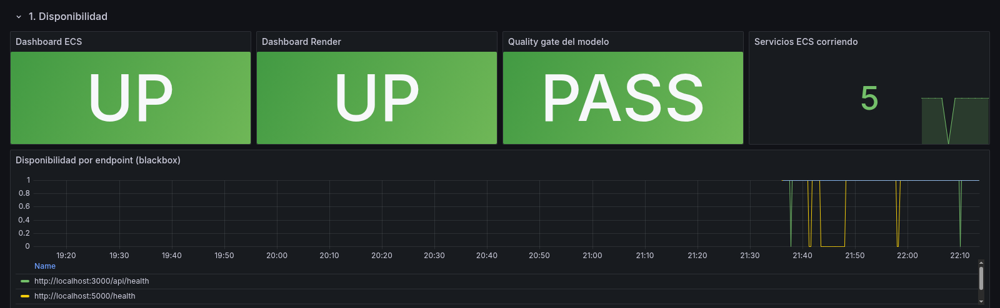
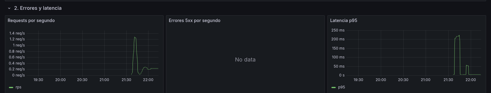
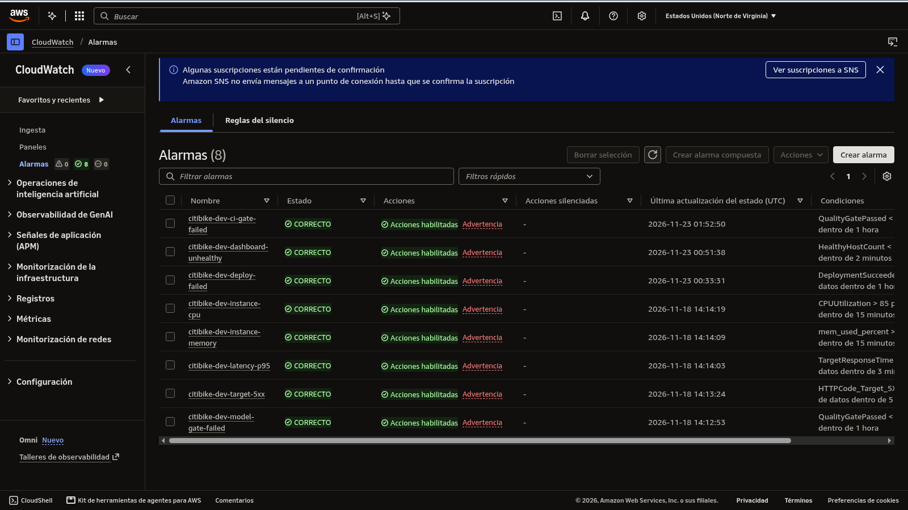
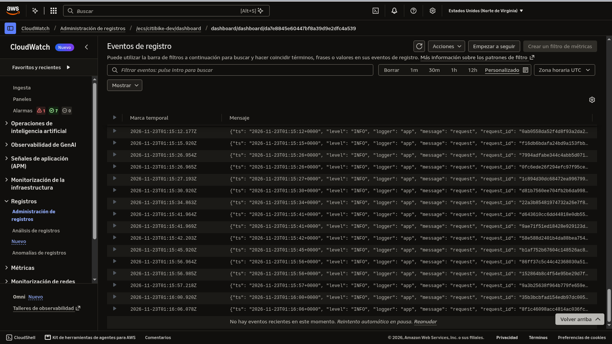
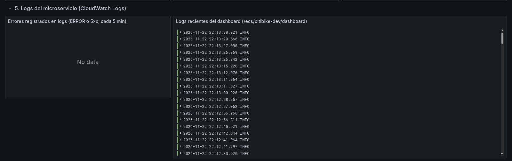
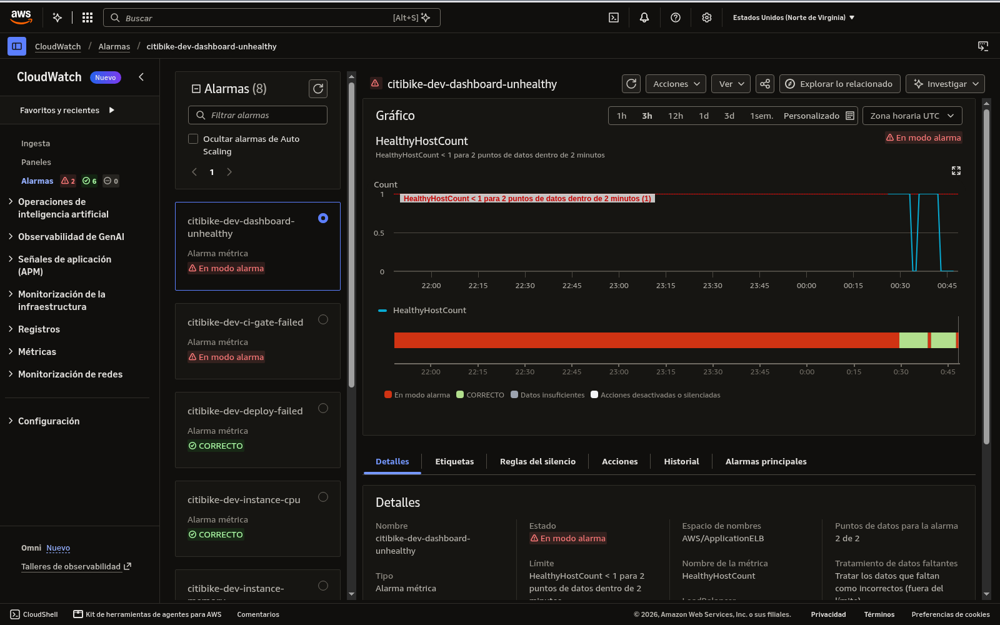

**Limitaciones a mencionar:** retención de Prometheus de 6 h (disco efímero);
Alertmanager no envía correo (las notificaciones salen por las alarmas de
CloudWatch vía SNS); no hay trazas distribuidas.

---

### 3.2 IE2 — Despliegue en entorno orquestado en la nube (20 %)

**Qué pide la rúbrica:** desplegar microservicios en un entorno orquestado en la
nube, integrando configuraciones de monitoreo, trazabilidad y observabilidad de
forma automatizada.

**Implementación:**

- **Terraform** crea VPC/red, ALB, target groups, instancia ECS-optimized,
  cluster, task definitions y 5 servicios.
- **ECS on EC2** con `LabInstanceProfile` y `LabRole`; no se crean roles IAM.
- **5 servicios**: `dashboard`, `prometheus`, `grafana`, `alertmanager`,
  `blackbox`, todos `1/1`.
- **`network_mode=host`** para el stack de monitoreo, con puertos fijos.
- **`deployment_minimum_healthy_percent=0` / `maximum=100`** para permitir
  rolling update en una sola instancia.
- **`ECS_IMAGE_PULL_BEHAVIOR=always`** para no reutilizar imágenes `:latest`
  cacheadas.
- **CloudWatch Agent** y **Container Insights** habilitados desde el
  `user_data`.
- **Job `deploy-ecs`** (pipeline de Flask-Dashboard-S3): en cada push a `main`
  registra una revisión de la task definition con la imagen `:<sha>`, actualiza
  el servicio, espera estabilidad, detecta un rollback del circuit breaker y
  publica `DeploymentDurationSeconds` y `DeploymentSucceeded`.
- **`deploy.sh`** permite medir un despliegue manual con las mismas métricas.
- **`verify.sh`** valida el estado end-to-end y devuelve exit code distinto de
  cero si algo falla.

**Evidencia:**

| # | Evidencia | Qué demuestra | Dónde verla | Resultado |
|---|---|---|---|---|
| 1 | Servicios ECS | 5 servicios `ACTIVE`, `1/1`, rollout `COMPLETED` | [`ecs-services.txt`](https://github.com/Sebithaz-dev/CitiBike-Infra/blob/main/docs/evidence/20261123T003653Z/ecs-services.txt) | 5/5 |
| 2 | Target groups | Targets del ALB en `healthy` | [`target-group-dashboard.txt`](https://github.com/Sebithaz-dev/CitiBike-Infra/blob/main/docs/evidence/20261123T003653Z/target-group-dashboard.txt), [`target-group-grafana.txt`](https://github.com/Sebithaz-dev/CitiBike-Infra/blob/main/docs/evidence/20261123T003653Z/target-group-grafana.txt) | 2/2 |
| 3 | Endpoints | `/health`, `/`, `/metrics` responden 200 | [`http-status.txt`](https://github.com/Sebithaz-dev/CitiBike-Infra/blob/main/docs/evidence/20261123T003653Z/http-status.txt) | 200 |
| 4 | Outputs de Terraform | ALB, cluster, instancia, log groups, URL interna de Prometheus | [`terraform-outputs.txt`](https://github.com/Sebithaz-dev/CitiBike-Infra/blob/main/docs/evidence/20261123T003653Z/terraform-outputs.txt) | Recursos creados |
| 5 | Verificación | Servicios, targets, endpoints y Grafana | [`verify.txt`](https://github.com/Sebithaz-dev/CitiBike-Infra/blob/main/docs/evidence/20261123T003653Z/verify.txt) | `Todo OK` |
| 6 | Duración de despliegue | `DeploymentDurationSeconds` | [`cloudwatch-cicd-values.txt`](https://github.com/Sebithaz-dev/CitiBike-Infra/blob/main/docs/evidence/20261123T003653Z/cloudwatch-cicd-values.txt) | 138 s / 142 s |
| 7 | Infraestructura como código | Recursos y configuraciones | [`terraform/`](https://github.com/Sebithaz-dev/CitiBike-Infra/tree/main/terraform) | `terraform plan` sin diferencias |
| 8 | Decisión ECS vs EKS | Restricciones y consecuencias | [`docs/ARCHITECTURE.md`](https://github.com/Sebithaz-dev/CitiBike-Infra/blob/main/docs/ARCHITECTURE.md) | Documentada |

**Capturas:**

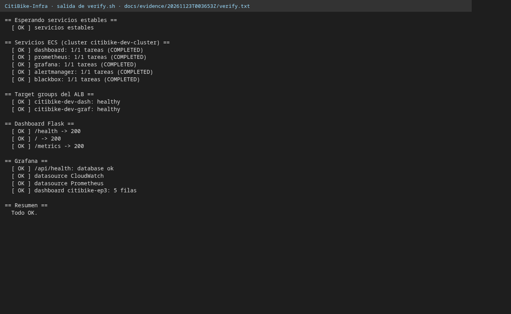
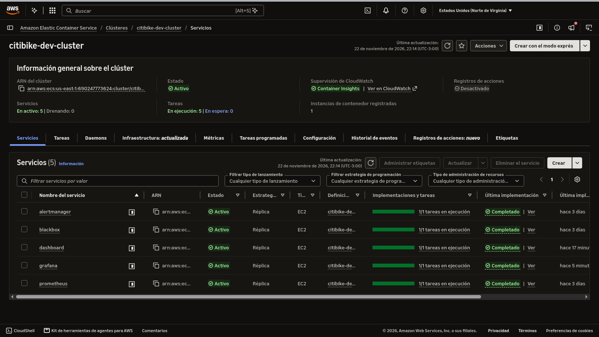
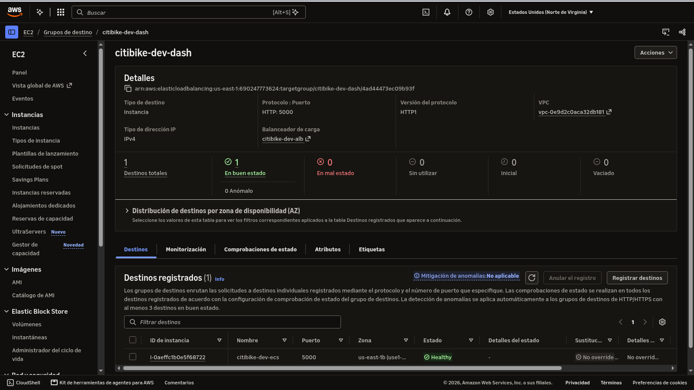

> ECS sigue siendo un entorno orquestado porque nosotros no lanzamos ni vigilamos
> los contenedores a mano: declaramos en Terraform cuántas tareas debe tener cada
> servicio y ECS se encarga de programarlas, reiniciarlas si caen y reemplazarlas
> en cada despliegue con un rolling update. Lo comprobamos en la falla controlada:
> al volver el servicio a una tarea deseada, ECS levantó el contenedor solo, el
> target group lo marcó `healthy` y la alarma volvió a `OK`. Además, el circuit
> breaker revierte un despliegue que no estabiliza. Es la misma idea de estado
> deseado que usa Kubernetes, aunque con un plano de control administrado por AWS.

---

### 3.3 IE3 — Dashboard con métricas clave integradas al CI/CD (10 %)

**Qué pide la rúbrica:** crear dashboards con tiempo de despliegue, cobertura de
pruebas, uso de CPU/memoria y errores registrados, integrados en el proceso
CI/CD.

**Dashboard `citibike-ep3` (5 filas):**

| Fila | Paneles | Fuente | Qué muestra |
|---|---|---|---|
| **1. Disponibilidad** | Dashboard ECS, Dashboard Render, Quality gate del modelo, Servicios ECS corriendo, Disponibilidad por endpoint (blackbox) | Prometheus + CloudWatch | Estado de los endpoints y del gate |
| **2. Errores y latencia** | Requests por segundo, Errores 5xx por segundo, Latencia p95 | Prometheus | Tráfico, errores y latencia del dashboard |
| **3. Recursos** | CPU/memoria del servicio `dashboard`, CPU/memoria de la instancia ECS | `ECS/ContainerInsights`, `AWS/EC2`, `CWAgent` | Consumo real de recursos |
| **4. CI/CD y modelo** | Duración del despliegue, Cobertura de tests por repo, ROC-AUC del modelo | `CitiBike/CI`, `CitiBike/Model` | Métricas del pipeline y del modelo |
| **5. Logs** | Errores registrados en logs (ERROR o 5xx), Logs recientes del dashboard | CloudWatch Logs (`/ecs/citibike-dev/dashboard`) | Errores registrados y detalle de cada request |

**Métricas publicadas:**

| Métrica | Namespace | Origen | Valor observado |
|---|---|---|---|
| `DeploymentDurationSeconds` | `CitiBike/CI` | Job `deploy-ecs` (o `scripts/deploy.sh`) | 138 s (job `deploy-ecs`) y 142 s (`deploy.sh`), sesión 23-11 |
| `DeploymentSucceeded` | `CitiBike/CI` | Job `deploy-ecs` y `scripts/deploy.sh` | 1 en ambos despliegues de la sesión 23-11 |
| `TestCoveragePercent` (`Repo=Flask-Dashboard-S3`) | `CitiBike/CI` | CI de Flask | 83,61 % |
| `TestCoveragePercent` (`Repo=Model-Training-S3`) | `CitiBike/CI` | CI de Model-Training | 90,07 % (mínimo exigido 60 %) |
| `TestsPassed` | `CitiBike/CI` | CI de Flask | 29 |
| `QualityGatePassed` | `CitiBike/CI` | CI de Flask y de Model-Training (1 si los tests pasan, 0 si fallan) | 1 |
| `roc_auc` | `CitiBike/Model` | `ml/metrics_export.py` | 0,6505 |
| `f1_score` | `CitiBike/Model` | `ml/metrics_export.py` | 0,4650 |
| `QualityGatePassed` | `CitiBike/Model` | `ml/metrics_export.py` | 1 |

**Evidencia:**

| # | Evidencia | Qué demuestra | Dónde verla |
|---|---|---|---|
| 1 | Dashboard JSON | 5 filas y paneles definidos como código | [`citibike-ep3.json`](https://github.com/Sebithaz-dev/CitiBike-Infra/blob/main/docker/grafana/dashboards/citibike-ep3.json) |
| 2 | Verificación | Grafana con datasources y dashboard de 5 filas | [`verify.txt`](https://github.com/Sebithaz-dev/CitiBike-Infra/blob/main/docs/evidence/20261123T003653Z/verify.txt) |
| 3 | Métricas de CI/CD | Valores en CloudWatch | [`cloudwatch-cicd-values.txt`](https://github.com/Sebithaz-dev/CitiBike-Infra/blob/main/docs/evidence/20261123T003653Z/cloudwatch-cicd-values.txt) |
| 4 | Métricas del modelo | `roc_auc`, `f1_score`, `QualityGatePassed` | [`ml/metrics_export.py`](https://github.com/Sebithaz-dev/Model-Training-S3/blob/main/ml/metrics_export.py), [`README.md` — últimas métricas](https://github.com/Sebithaz-dev/Model-Training-S3/blob/main/README.md#últimas-métricas-test-temporal) |
| 5 | Cobertura publicada desde Flask | Workflow `ci-cd.yml` y run exitoso | [PR #25](https://github.com/Sebithaz-dev/Flask-Dashboard-S3/pull/25), [run 44588927968](https://github.com/Sebithaz-dev/Flask-Dashboard-S3/actions/runs/44588927968) |
| 6 | Script de métricas | `ci_metrics.py` para workflows y tests | [`scripts/ci_metrics.py`](https://github.com/Sebithaz-dev/CitiBike-Infra/blob/main/scripts/ci_metrics.py) |

**Capturas:**

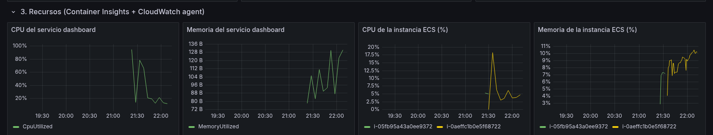
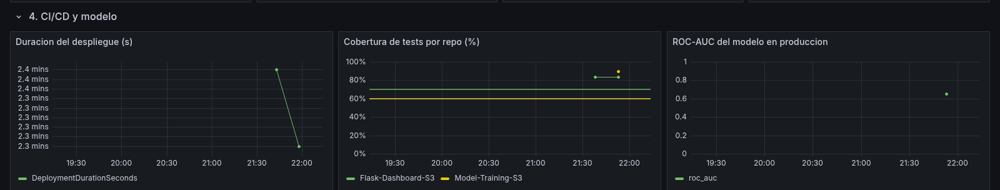
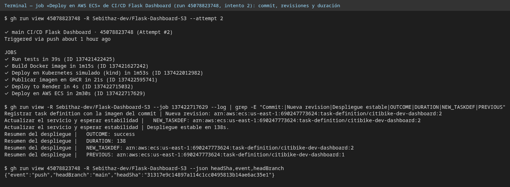

> Un caso real nos pasó en la sesión del 23-11: las filas 3 y 4 del dashboard
> mostraban *No data* aunque las métricas existían en CloudWatch. En vez de
> asumir que el pipeline no estaba publicando, consultamos la API de Grafana y
> vimos que los datos sí llegaban; el problema era que a las consultas les
> faltaban campos y Grafana ni siquiera las enviaba. Esa señal nos llevó a corregir
> el dashboard (PR #19 de CitiBike-Infra) antes de sacar las capturas. Del mismo
> modo, si el panel de cobertura bajara del 70 % en Flask, no mergearíamos el
> cambio hasta agregar tests.

---

### 3.4 IE4 — Documentación de la integración en el pipeline (10 %)

**Qué pide la rúbrica:** documentar cómo se integran monitoreo, métricas y
seguridad en el pipeline, y cómo permiten tomar decisiones técnicas informadas.

**Documentación disponible:**

| Documento | Contenido | Enlace |
|---|---|---|
| `README.md` (Model-Training-S3) | Arquitectura, setup, pipeline de entrenamiento, CI/CD, seguridad y TBD | [Ver](https://github.com/Sebithaz-dev/Model-Training-S3/blob/main/README.md) |
| `docs/ARCHITECTURE.md` | Restricciones, decisiones ECS/observabilidad, flujo de despliegue, mapeo IE y riesgos | [Ver](https://github.com/Sebithaz-dev/CitiBike-Infra/blob/main/docs/ARCHITECTURE.md) |
| `docs/RUNBOOK.md` | Operación: inicio de sesión, verificación, alarmas, problemas comunes y cierre | [Ver](https://github.com/Sebithaz-dev/CitiBike-Infra/blob/main/docs/RUNBOOK.md) |
| `docs/COMPLIANCE.md` | Controles C1–C13, modos de auditoría, IE6 y referencias normativas | [Ver](https://github.com/Sebithaz-dev/CitiBike-Infra/blob/main/docs/COMPLIANCE.md) |
| `docs/TESTING.md` | 9 pasos de verificación manual, incluida una falla controlada y un PR bloqueado | [Ver](https://github.com/Sebithaz-dev/CitiBike-Infra/blob/main/docs/TESTING.md) |
| `docs/INFORME_EP3.md` | Este informe | — |


---

### 3.5 IE5 — Políticas de cumplimiento y auditoría (20 %)

**Qué pide la rúbrica:** aplicar políticas de cumplimiento con SonarQube, branch
protection o scripts de auditoría automatizada, garantizando calidad, seguridad
y trazabilidad.

**Controles implementados (resumen de C1–C13):**

| # | Control | Herramienta | Dónde se aplica |
|---|---|---|---|
| C1 | PR obligatorio hacia `main`, sin push directo | Branch protection | Los 3 repos |
| C2 | Checks requeridos y estrictos (`strict=true`) | Branch protection | Los 3 repos |
| C3 | Force-push y borrado de `main` bloqueados | Branch protection | Los 3 repos |
| C4 | Historial lineal y conversaciones resueltas | Branch protection | Los 3 repos |
| C5 | Revisión por dueños del área | `CODEOWNERS` | Los 3 repos |
| C6 | Dependencias actualizadas de forma controlada | `dependabot.yml` | Los 3 repos |
| C7 | Reporte de vulnerabilidades | `SECURITY.md` | Los 3 repos |
| C8 | Secret scanning y push protection | GitHub Advanced Security | Los 3 repos |
| C9 | SAST + dependencias | Snyk + SonarCloud | Flask, Model-Training |
| C10 | Cobertura mínima como gate | `pytest-cov` | Model-Training (60 %), Flask (70 %) |
| C11 | Quality gate del modelo antes de publicar en S3 | `ml/quality_gate.py` + YAML | Model-Training |
| C12 | `terraform fmt/validate` y validación de configs | `infra-ci.yml` | CitiBike-Infra |
| C13 | Auditoría de cumplimiento automática | `scripts/audit_compliance.py` | CitiBike-Infra |

**Resultado de la última auditoría (modo estricto):**

```text
47 controles, 0 fallas, 0 no evaluables
```

Evidencia: [`compliance.txt`](https://github.com/Sebithaz-dev/CitiBike-Infra/blob/main/docs/evidence/20261119T183438Z/compliance.txt)
y [`compliance.md`](https://github.com/Sebithaz-dev/CitiBike-Infra/blob/main/docs/evidence/20261119T183438Z/compliance.md).

**Cómo reproducirla:**

```bash
cd CitiBike-Infra
python3 scripts/audit_compliance.py --strict
python3 scripts/audit_compliance.py --strict --markdown > auditoria.md
```

**Capturas:**

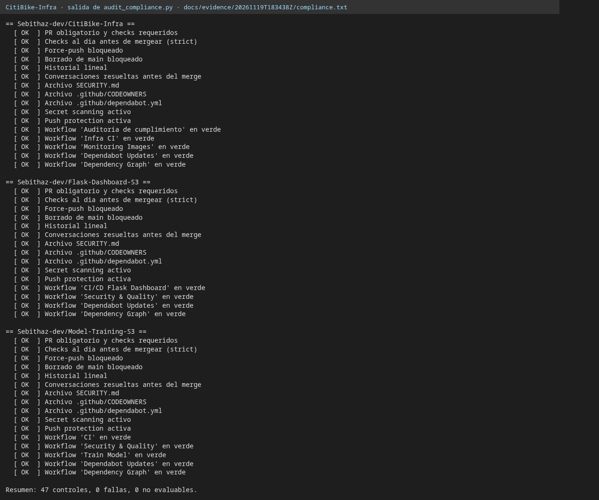
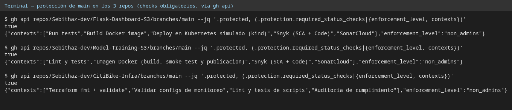

---

### 3.6 IE6 — Gates que detienen el pipeline (20 %)

**Qué pide la rúbrica:** implementar mecanismos que interrumpan automáticamente
el pipeline ante fallas críticas de seguridad o calidad.

**Gates implementados:**

| Falla | Detector | Efecto | Evidencia |
|---|---|---|---|
| Test roto o cobertura bajo el umbral | `Run tests` / `Lint y tests` | Check requerido rojo → merge bloqueado | [`ie6-gate-bloqueante.txt`](https://github.com/Sebithaz-dev/CitiBike-Infra/blob/main/docs/evidence/20261123T003653Z/ie6-gate-bloqueante.txt) |
| Vulnerabilidad alta o crítica | `Snyk (SCA + Code)` | Check requerido rojo | [`security.yml`](https://github.com/Sebithaz-dev/Model-Training-S3/blob/main/.github/workflows/security.yml), demo en [`docs/TESTING.md` §6.1](https://github.com/Sebithaz-dev/CitiBike-Infra/blob/main/docs/TESTING.md) |
| Deuda de calidad sobre el umbral | `SonarCloud` | Check requerido rojo | [`security.yml`](https://github.com/Sebithaz-dev/Model-Training-S3/blob/main/.github/workflows/security.yml) |
| Modelo bajo el umbral | `ml/quality_gate.py` | `ml.train` no publica en S3 y el workflow falla | [`quality_gate.yaml`](https://github.com/Sebithaz-dev/Model-Training-S3/blob/main/config/quality_gate.yaml) |
| Infraestructura inválida | `Terraform fmt + validate` / configs de monitoreo | Check requerido rojo | [`infra-ci.yml`](https://github.com/Sebithaz-dev/CitiBike-Infra/blob/main/.github/workflows/infra-ci.yml) |
| Servicio caído en producción | Alarma `*-dashboard-unhealthy` + `DashboardDown` | Alarma en `ALARM` visible en CloudWatch/Grafana | [`monitoring.tf`](https://github.com/Sebithaz-dev/CitiBike-Infra/blob/main/terraform/monitoring.tf) |
| Despliegue que no estabiliza | Circuit breaker de ECS + job `deploy-ecs` | Rollback automático; el job falla y publica `DeploymentSucceeded=0` → alarma `deploy-failed` | [`ecs.tf`](https://github.com/Sebithaz-dev/CitiBike-Infra/blob/main/terraform/ecs.tf), [`ci-cd.yml`](https://github.com/Sebithaz-dev/Flask-Dashboard-S3/blob/main/.github/workflows/ci-cd.yml) |
| Gate de CI fallido | `QualityGatePassed=0` publicado por el CI aunque los tests fallen | Alarma `ci-gate-failed` en `ALARM` + correo SNS | [`monitoring.tf`](https://github.com/Sebithaz-dev/CitiBike-Infra/blob/main/terraform/monitoring.tf) |

**Evidencia empírica del PR bloqueado (PR #24 de Flask):**

| Check | Resultado |
|---|---|
| `Run tests` | ❌ `fail` |
| `SonarCloud` | ❌ `fail` |
| `Build Docker image` | ⏭️ `skipping` |
| `Deploy en Kubernetes simulado (kind)` | ⏭️ `skipping` |
| `Deploy to Render` | ⏭️ `skipping` |
| `Publicar imagen en GHCR` | ⏭️ `skipping` |
| `mergeStateStatus` | 🔒 `BLOCKED` |

Evidencia: [`ie6-gate-bloqueante.txt`](https://github.com/Sebithaz-dev/CitiBike-Infra/blob/main/docs/evidence/20261119T183438Z/ie6-gate-bloqueante.txt)  
PR (cerrado después de la captura): <https://github.com/Sebithaz-dev/Flask-Dashboard-S3/pull/24>  
Repetido el 23-11 con el PR [#28](https://github.com/Sebithaz-dev/Flask-Dashboard-S3/pull/28) (mismo resultado, más `Deploy en AWS ECS` en `skipping`): [`ie6-gate-bloqueante.txt`](https://github.com/Sebithaz-dev/CitiBike-Infra/blob/main/docs/evidence/20261123T003653Z/ie6-gate-bloqueante.txt)

**Quality gate del modelo (umbrales y valores):**

| Métrica | Umbral | Valor | Estado |
|---|---:|---:|---|
| `roc_auc` | ≥ 0,62 | 0,6505 | ✅ |
| `pr_auc` | ≥ 0,40 | 0,4455 | ✅ |
| `f1_score` | ≥ 0,42 | 0,4650 | ✅ |
| `recall` | ≥ 0,60 | 0,7035 | ✅ |
| `precision` | ≥ 0,30 | 0,3473 | ✅ |
| `accuracy` | ≥ 0,52 | 0,5500 | ✅ |
| `test_size` | ≥ 1.000 | 94.686 | ✅ |

**Cómo ver el gate en local:**

```bash
cd Model-Training-S3
python -m ml.quality_gate --metrics ml/artefactos/metricas.json --json
# exit code 0 si pasa; 1 si alguna métrica queda bajo el umbral
```

Para simular una falla sin tocar el modelo real, copiar `metricas.json` a
`/tmp`, bajar `roc_auc` a `0.10` y ejecutar el gate contra esa copia.

**Capturas:**

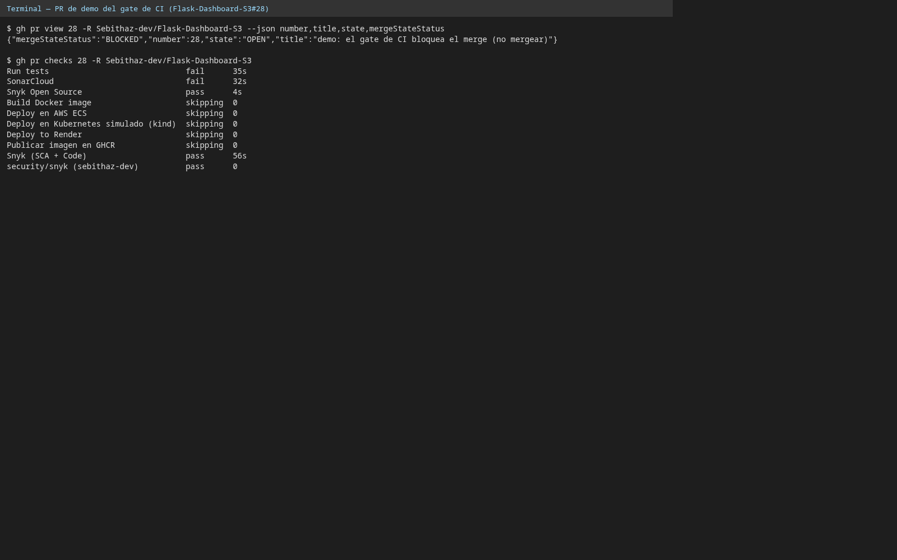
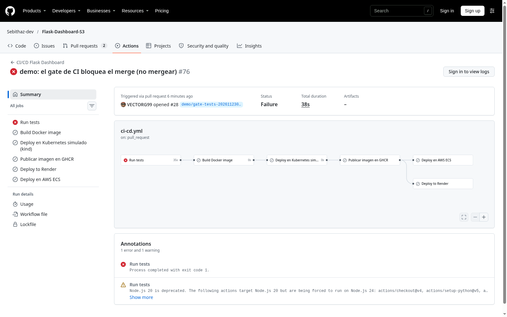
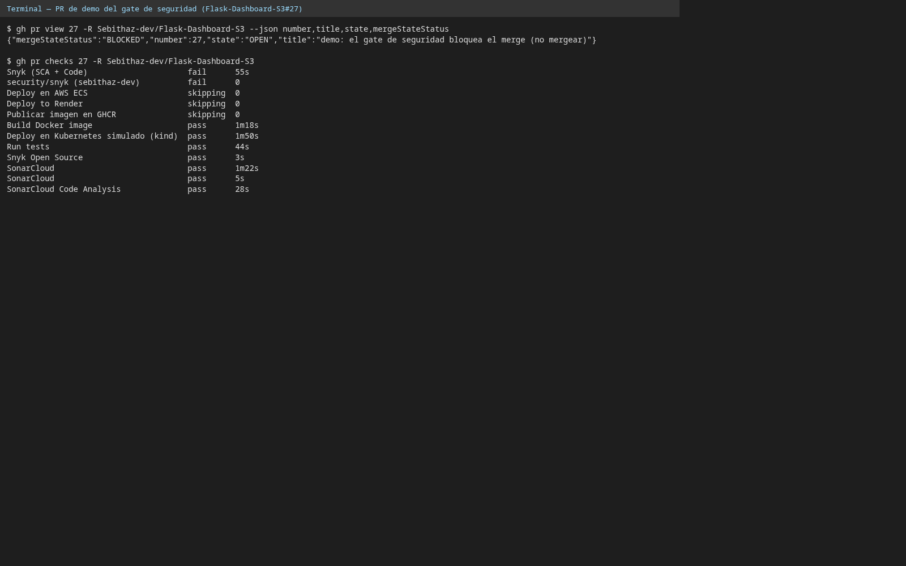

---

## 4. Matriz consolidada IE → evidencia

| IE | Peso | Qué se exige | Evidencia principal | Evidencia complementaria | Estado |
|---|---:|---|---|---|---|
| **IE1** | 20 % | Monitoreo, logs, métricas y disponibilidad | [`verify.txt`](https://github.com/Sebithaz-dev/CitiBike-Infra/blob/main/docs/evidence/20261123T003653Z/verify.txt), [`prometheus-up.txt`](https://github.com/Sebithaz-dev/CitiBike-Infra/blob/main/docs/evidence/20261123T003653Z/prometheus-up.txt) | [`cloudwatch-alarms.txt`](https://github.com/Sebithaz-dev/CitiBike-Infra/blob/main/docs/evidence/20261123T003653Z/cloudwatch-alarms.txt), dashboard, logs | ✅ Implementado y verificado |
| **IE2** | 20 % | Despliegue orquestado en la nube con observabilidad | [`ecs-services.txt`](https://github.com/Sebithaz-dev/CitiBike-Infra/blob/main/docs/evidence/20261123T003653Z/ecs-services.txt), [`target-group-dashboard.txt`](https://github.com/Sebithaz-dev/CitiBike-Infra/blob/main/docs/evidence/20261123T003653Z/target-group-dashboard.txt) | [`terraform-outputs.txt`](https://github.com/Sebithaz-dev/CitiBike-Infra/blob/main/docs/evidence/20261123T003653Z/terraform-outputs.txt), `terraform/` | ✅ Implementado y verificado |
| **IE3** | 10 % | Dashboard con métricas de despliegue, cobertura, recursos y errores | [`citibike-ep3.json`](https://github.com/Sebithaz-dev/CitiBike-Infra/blob/main/docker/grafana/dashboards/citibike-ep3.json), [`cloudwatch-cicd-values.txt`](https://github.com/Sebithaz-dev/CitiBike-Infra/blob/main/docs/evidence/20261123T003653Z/cloudwatch-cicd-values.txt) | [Run 44588927968](https://github.com/Sebithaz-dev/Flask-Dashboard-S3/actions/runs/44588927968), `ml/metrics_export.py` | ✅ Implementado con datos reales |
| **IE4** | 10 % | Documentar la integración y su impacto en decisiones | `README.md`, `docs/ARCHITECTURE.md`, `docs/RUNBOOK.md`, `docs/COMPLIANCE.md`, `docs/TESTING.md` | Este informe y sus secciones 5–9 | ✅ |
| **IE5** | 20 % | Políticas de cumplimiento y auditoría automatizada | [`compliance.txt`](https://github.com/Sebithaz-dev/CitiBike-Infra/blob/main/docs/evidence/20261119T183438Z/compliance.txt), [`compliance.md`](https://github.com/Sebithaz-dev/CitiBike-Infra/blob/main/docs/evidence/20261119T183438Z/compliance.md) | [`audit_compliance.py`](https://github.com/Sebithaz-dev/CitiBike-Infra/blob/main/scripts/audit_compliance.py), [`COMPLIANCE.md`](https://github.com/Sebithaz-dev/CitiBike-Infra/blob/main/docs/COMPLIANCE.md) | ✅ 47/47 controles |
| **IE6** | 20 % | Gates que detienen el pipeline ante fallas críticas | [`ie6-gate-bloqueante.txt`](https://github.com/Sebithaz-dev/CitiBike-Infra/blob/main/docs/evidence/20261123T003653Z/ie6-gate-bloqueante.txt) | [`quality_gate.yaml`](https://github.com/Sebithaz-dev/Model-Training-S3/blob/main/config/quality_gate.yaml), workflows, circuit breaker | ✅ Implementado y demostrado |

**Cobertura de la rúbrica:** IE1, IE2, IE3, IE5 e IE6 están implementados y
evidenciados (90 % de la ponderación). IE4 queda parcial hasta que el equipo
complete la narrativa de las secciones 5–9 y la sección 10.

---

## 5. Integración en el pipeline CI/CD (IE4)

### 5.1 Etapas y herramientas

| Etapa | Herramienta | Qué valida | Si falla | Evidencia |
|---|---|---|---|---|
| Desarrollo local | `ruff`, `pytest`, `pytest-cov` | Estilo, tests y cobertura | No se abre el PR o se corrige antes | `pyproject.toml`, `requirements-dev.txt` |
| Pull request | GitHub Actions `CI` | Lint, tests, cobertura ≥ 60 %, health check | Check rojo | [`.github/workflows/ci.yml`](https://github.com/Sebithaz-dev/Model-Training-S3/blob/main/.github/workflows/ci.yml) |
| Pull request | Snyk + SonarCloud | Vulnerabilidades y calidad | Check rojo | [`.github/workflows/security.yml`](https://github.com/Sebithaz-dev/Model-Training-S3/blob/main/.github/workflows/security.yml) |
| Pull request | Build + smoke test | Imagen construible y saludable | Check rojo | `ci.yml` (job `docker`) |
| Merge | Branch protection | PR, checks estrictos, conversaciones, CODEOWNERS | Merge bloqueado | [`COMPLIANCE.md`](https://github.com/Sebithaz-dev/CitiBike-Infra/blob/main/docs/COMPLIANCE.md) |
| Entrenamiento | `ml/train.py` + `quality_gate.py` | Métricas mínimas antes de publicar en S3 | Workflow rojo, sin artefactos nuevos | [`quality_gate.yaml`](https://github.com/Sebithaz-dev/Model-Training-S3/blob/main/config/quality_gate.yaml) |
| Infraestructura | Terraform + validación de configs | Recursos válidos y reproducibles | Check rojo | [`.github/workflows/infra-ci.yml`](https://github.com/Sebithaz-dev/CitiBike-Infra/blob/main/.github/workflows/infra-ci.yml) |
| Cumplimiento | `audit_compliance.py` | Gobierno, protección y workflows | Check rojo | [`.github/workflows/compliance.yml`](https://github.com/Sebithaz-dev/CitiBike-Infra/blob/main/.github/workflows/compliance.yml) |
| Despliegue | Job `deploy-ecs` + ECS | Rolling update, estabilidad y que no haya rollback | Job rojo, `DeploymentSucceeded=0`, alarma `deploy-failed` | [`ci-cd.yml`](https://github.com/Sebithaz-dev/Flask-Dashboard-S3/blob/main/.github/workflows/ci-cd.yml) |
| Operación | Prometheus + Grafana + CloudWatch | Disponibilidad, errores, latencia, recursos | Alarma / dashboard en rojo | [`monitoring.tf`](https://github.com/Sebithaz-dev/CitiBike-Infra/blob/main/terraform/monitoring.tf) |

### 5.2 Decisiones que habilita el pipeline

| Señal | Decisión técnica | Dónde se ve |
|---|---|---|
| Cobertura < 60 % (modelo) o < 70 % (Flask) | No mergear; agregar tests | Check `Lint y tests` / `Run tests` |
| `roc_auc` < 0,62 o `f1_score` < 0,42 | No publicar el modelo en S3 | `ml/quality_gate.py` |
| Vulnerabilidad alta/crítica | No mergear; actualizar dependencia | `Snyk (SCA + Code)` |
| Quality gate de SonarCloud en rojo | No mergear; reducir deuda | `SonarCloud` |
| Latencia p95 > 1,5 s o 5xx > 5 | Investigar; revisar dashboard y logs | Alarmas `latency-p95`, `target-5xx` |
| Servicio caído | Reiniciar/rollback; revisar `verify.sh` | Alarma `dashboard-unhealthy` |
| Auditoría con fallas | Corregir gobierno antes de seguir | `Auditoria de cumplimiento` |

> El ejemplo más claro fue el gate de seguridad: abrimos un PR que agregaba
> `django==2.2` y Snyk lo marcó en rojo por vulnerabilidades críticas, dejando el
> PR en `BLOCKED` (PR #27 de Flask-Dashboard-S3). La decisión fue no mergear y
> cerrar el PR; en un caso real habríamos actualizado la dependencia. También el
> PR #28, con un test que falla, publicó `QualityGatePassed=0`: la alarma
> `ci-gate-failed` pasó a `ALARM` y nos recordó que esa señal también llega a la
> operación, no solo a GitHub.

### 5.3 Documentación de soporte

- [`README.md` de Model-Training-S3](https://github.com/Sebithaz-dev/Model-Training-S3/blob/main/README.md):
  arquitectura, setup, pipeline, CI/CD y TBD.
- [`docs/ARCHITECTURE.md`](https://github.com/Sebithaz-dev/CitiBike-Infra/blob/main/docs/ARCHITECTURE.md):
  restricciones, decisiones, flujo de despliegue y riesgos.
- [`docs/RUNBOOK.md`](https://github.com/Sebithaz-dev/CitiBike-Infra/blob/main/docs/RUNBOOK.md):
  operación y troubleshooting.
- [`docs/COMPLIANCE.md`](https://github.com/Sebithaz-dev/CitiBike-Infra/blob/main/docs/COMPLIANCE.md):
  controles y referencias normativas.
- [`docs/TESTING.md`](https://github.com/Sebithaz-dev/CitiBike-Infra/blob/main/docs/TESTING.md):
  verificación manual paso a paso.

---

## 6. Cumplimiento y auditoría (IE5)

La auditoría recorre los tres repositorios y verifica:

1. Protección de `main`: PR obligatorio, checks requeridos, `strict`, force-push
   y borrado bloqueados, historial lineal, conversaciones resueltas.
2. Archivos de gobierno: `SECURITY.md`, `.github/CODEOWNERS`,
   `.github/dependabot.yml`.
3. Secret scanning y push protection.
4. Último run en `main` de cada workflow en verde.

**Resultado de la sesión 2026-11-19:**

```text
47 controles, 0 fallas, 0 no evaluables
```

**Modos de ejecución:**

| Modo | Token | Protección de rama | Uso |
|---|---|---|---|
| `--strict` | Token de `gh auth` con administración | Se evalúa y un `SKIP` cuenta como falla | Evidencia para el informe |
| Sin `--strict` | `GITHUB_TOKEN` de Actions | Se marca `SKIP` | CI de cada PR |

**Evidencia:**

- [`compliance.txt`](https://github.com/Sebithaz-dev/CitiBike-Infra/blob/main/docs/evidence/20261119T183438Z/compliance.txt)
- [`compliance.md`](https://github.com/Sebithaz-dev/CitiBike-Infra/blob/main/docs/evidence/20261119T183438Z/compliance.md)
- [`scripts/audit_compliance.py`](https://github.com/Sebithaz-dev/CitiBike-Infra/blob/main/scripts/audit_compliance.py)
- [`docs/COMPLIANCE.md`](https://github.com/Sebithaz-dev/CitiBike-Infra/blob/main/docs/COMPLIANCE.md)

> Aplicamos las políticas como código y no como una lista para revisar a mano:
> la protección de `main`, los checks obligatorios, CODEOWNERS, Dependabot y el
> secret scanning están configurados en los tres repositorios, y
> `audit_compliance.py` los verifica en cada PR. El control que más nos sirvió fue
> la protección de rama con checks obligatorios, porque convierte a todos los
> demás (tests, cobertura, Snyk, SonarCloud) en una regla real: sin ella, un check
> en rojo sería solo una advertencia y el código igual podría llegar a `main`.

---

## 7. Demostración del gate bloqueante (IE6)

### 7.1 Caso real: PR con un test que falla

Se creó el PR [#24](https://github.com/Sebithaz-dev/Flask-Dashboard-S3/pull/24)
con un test que falla a propósito (`assert False`). El resultado fue:

```text
Run tests                                  fail
SonarCloud                                 fail
Build Docker image                         skipping
Deploy en Kubernetes simulado (kind)       skipping
Deploy to Render                           skipping
Publicar imagen en GHCR                    skipping
mergeStateStatus                           BLOCKED
```

La captura completa está en
[`ie6-gate-bloqueante.txt`](https://github.com/Sebithaz-dev/CitiBike-Infra/blob/main/docs/evidence/20261119T183438Z/ie6-gate-bloqueante.txt).
El PR se cerró después de capturar la evidencia.

En la sesión del 23-11 se repitió con el PR
[#28](https://github.com/Sebithaz-dev/Flask-Dashboard-S3/pull/28)
([`ie6-gate-bloqueante.txt`](https://github.com/Sebithaz-dev/CitiBike-Infra/blob/main/docs/evidence/20261123T003653Z/ie6-gate-bloqueante.txt)) y se probó el gate de seguridad con el PR
[#27](https://github.com/Sebithaz-dev/Flask-Dashboard-S3/pull/27), que agrega
`django==2.2`: `Snyk (SCA + Code)` y `security/snyk` en `fail` y el PR en
`BLOCKED` ([`ie6-gate-seguridad.txt`](https://github.com/Sebithaz-dev/CitiBike-Infra/blob/main/docs/evidence/20261123T003653Z/ie6-gate-seguridad.txt)). Ambos PRs se
cerraron sin mergear.

### 7.2 Caso del modelo: quality gate antes de S3

`ml/train.py` evalúa las métricas contra `config/quality_gate.yaml`. Si alguna
métrica queda bajo el umbral, no se suben los artefactos a S3 y el workflow
termina con error. Los umbrales actuales y los valores del modelo están en la
sección 3.6.

### 7.3 Caso de infraestructura: Terraform inválido

`infra-ci.yml` ejecuta `terraform fmt -check`, `terraform validate` y la
validación de las configuraciones de monitoreo. Un error de sintaxis o una
configuración inválida deja el check requerido en rojo y bloquea el merge.

### 7.4 Caso de operación: alarma y circuit breaker

- **Alarma `citibike-dev-dashboard-unhealthy`**: si el target del ALB no tiene
  hosts sanos, pasa a `ALARM`.
- **Alarma `citibike-dev-target-5xx`**: errores 5xx por encima de 5.
- **Alarma `citibike-dev-latency-p95`**: latencia p95 por encima de 1,5 s.
- **Circuit breaker de ECS**: si una task nueva no arranca, ECS hace rollback a
  la definición anterior.

Procedimiento reproducible para ver una alarma en vivo:
[`docs/TESTING.md` §5](https://github.com/Sebithaz-dev/CitiBike-Infra/blob/main/docs/TESTING.md).

---

## 8. Resultados y métricas

### 8.1 Disponibilidad

| Endpoint | Estado | Evidencia |
|---|---|---|
| Dashboard ECS `/health` | 200 | [`http-status.txt`](https://github.com/Sebithaz-dev/CitiBike-Infra/blob/main/docs/evidence/20261123T003653Z/http-status.txt) |
| Dashboard ECS `/` | 200 | [`http-status.txt`](https://github.com/Sebithaz-dev/CitiBike-Infra/blob/main/docs/evidence/20261123T003653Z/http-status.txt) |
| Dashboard ECS `/metrics` | 200 | [`http-status.txt`](https://github.com/Sebithaz-dev/CitiBike-Infra/blob/main/docs/evidence/20261123T003653Z/http-status.txt) |
| Grafana `/api/health` | 200 | [`http-status.txt`](https://github.com/Sebithaz-dev/CitiBike-Infra/blob/main/docs/evidence/20261123T003653Z/http-status.txt) |
| Render `/health` | `up=1` | [`prometheus-up.txt`](https://github.com/Sebithaz-dev/CitiBike-Infra/blob/main/docs/evidence/20261123T003653Z/prometheus-up.txt) |
| Prometheus | `up=1` | [`prometheus-up.txt`](https://github.com/Sebithaz-dev/CitiBike-Infra/blob/main/docs/evidence/20261123T003653Z/prometheus-up.txt) |

### 8.2 CI/CD

| Métrica | Valor | Fuente |
|---|---:|---|
| Cobertura de tests de Flask | 83,61 % | [Run 44588927968](https://github.com/Sebithaz-dev/Flask-Dashboard-S3/actions/runs/44588927968) |
| Tests de Flask | 29 pasados | [Run 44588927968](https://github.com/Sebithaz-dev/Flask-Dashboard-S3/actions/runs/44588927968) |
| Duración del despliegue | 138 s (`deploy-ecs`) / 142 s (`deploy.sh`) | [`cloudwatch-cicd-values.txt`](https://github.com/Sebithaz-dev/CitiBike-Infra/blob/main/docs/evidence/20261123T003653Z/cloudwatch-cicd-values.txt) |
| `QualityGatePassed` (CI) | 1 | [`cloudwatch-cicd-values.txt`](https://github.com/Sebithaz-dev/CitiBike-Infra/blob/main/docs/evidence/20261123T003653Z/cloudwatch-cicd-values.txt) |
| Controles de cumplimiento | 47/47 | [`compliance.txt`](https://github.com/Sebithaz-dev/CitiBike-Infra/blob/main/docs/evidence/20261119T183438Z/compliance.txt) |

### 8.3 Modelo

| Métrica | Valor | Umbral | Estado |
|---|---:|---:|---|
| ROC-AUC | 0,6505 | ≥ 0,62 | ✅ |
| PR-AUC | 0,4455 | ≥ 0,40 | ✅ |
| F1 | 0,4650 | ≥ 0,42 | ✅ |
| Recall | 0,7035 | ≥ 0,60 | ✅ |
| Precision | 0,3473 | ≥ 0,30 | ✅ |
| Accuracy | 0,5500 | ≥ 0,52 | ✅ |
| Test size | 94.686 | ≥ 1.000 | ✅ |

Fuente: [`README.md` — últimas métricas](https://github.com/Sebithaz-dev/Model-Training-S3/blob/main/README.md#últimas-métricas-test-temporal)
y [`quality_gate.yaml`](https://github.com/Sebithaz-dev/Model-Training-S3/blob/main/config/quality_gate.yaml).

### 8.4 Recursos observados

| Recurso | Ventana | Valor observado | Fuente |
|---|---|---:|---|
| CPU de la instancia ECS | sesión 2026-11-19 | 3–20 % | `AWS/EC2` en Grafana/CloudWatch |
| Memoria de la instancia | sesión 2026-11-19 | ≈ 6–8 % | `CWAgent` |
| CPU del servicio `dashboard` | sesión 2026-11-19 | ≈ 12–13 % | `ECS/ContainerInsights` |

> Estos valores son una muestra de la sesión, no un benchmark. Sirven para
> demostrar que las métricas de host y de contenedor están llegando al
> dashboard.

---

## 9. Limitaciones y trabajo futuro

### 9.1 Limitaciones (hechos)

| Limitación | Impacto | Mitigación actual |
|---|---|---|
| Una sola instancia ECS | Punto único de falla | Runbook, circuit breaker, recreación con Terraform |
| Prometheus con retención de 6 h | No hay histórico largo | CloudWatch conserva métricas y logs |
| Alertmanager sin correo | Las alertas de Prometheus no llegan por email | Las alarmas equivalentes de CloudWatch notifican por SNS (`alarm_email`) |
| Dashboard público sin TLS | Tráfico sin cifrar | Excepción de demo documentada; en producción ACM + HTTPS |
| Credenciales del Learner Lab de 4 h | Los workflows se degradan sin credenciales | Preflight y warning en `train.yml` / CI de Flask |
| ECS en lugar de EKS | No hay portabilidad directa de Kubernetes | Manifiestos de EP2 conservados; decisión documentada |
| Sin trazas distribuidas | No se sigue una request entre servicios | `request_id` en logs JSON; Istio/Kiali o X-Ray como trabajo futuro |
| Entrenamiento programado sin credenciales | `train.yml` se omite en verde si las credenciales del lab vencieron | Resumen "Entrenamiento omitido" en el run; relanzar con `workflow_dispatch` |

### 9.2 Trabajo futuro

- **HTTPS en el balanceador** con un certificado de ACM y redirección de 80 a 443.
- **Alta disponibilidad:** un Auto Scaling Group con dos instancias en zonas
  distintas y autoescalado del servicio `dashboard` por CPU.
- **Trazas distribuidas** con OpenTelemetry y AWS X-Ray, o un service mesh
  (Istio + Kiali) si se migra a EKS.
- **Notificaciones de Alertmanager** por SNS o Slack, para que las alertas de
  Prometheus también avisen sin depender de CloudWatch.
- **Histórico de métricas** de Prometheus en almacenamiento persistente (EBS o
  Amazon Managed Prometheus), en lugar de la retención de 6 horas.

---

## 10. Conclusiones y reflexiones individuales

> **IMPORTANTE — LEER ANTES DE ESCRIBIR.**
>
> La pauta de la EP3 prohíbe usar inteligencia artificial para redactar
> **conclusiones, justificaciones técnicas o reflexiones individuales**. Esta
> sección debe escribirse **sin IA**, con las palabras de cada integrante.
>
> No se entrega texto generado automáticamente en esta sección. Si se usó IA en
> otras partes, ya quedó declarado al inicio del informe.

### 10.1 Conclusiones del equipo

La principal lección de esta entrega es que observar un sistema no es lo mismo
que tener métricas. Al principio publicábamos datos en CloudWatch y Prometheus,
pero recién al provocar una falla controlada vimos el ciclo completo: el servicio
cae, la alarma pasa a `ALARM`, el dashboard se pone en rojo y, al recuperarse,
todo vuelve a `OK`. Esa prueba nos dio más confianza que cualquier captura de un
sistema sano.

También entendimos que un gate solo sirve si de verdad bloquea. Los checks de
tests, cobertura, Snyk y SonarCloud existían desde la EP2, pero recién al
hacerlos obligatorios en la protección de `main` y demostrarlo con PRs de prueba
(un test roto y una dependencia vulnerable) pasaron de ser advertencias a ser
reglas.

La decisión más difícil fue usar ECS en lugar de Kubernetes. Implicó dejar de
lado lo que habíamos hecho con `kind` en la EP2 y adaptarnos a las restricciones
del Learner Lab: sin roles de IAM propios, una sola instancia y credenciales que
vencen cada cuatro horas. Tuvimos que resolver problemas que no esperábamos,
como redesplegar servicios con red de host en una sola instancia o recursos que
quedaron vivos de una sesión anterior.

En una próxima entrega haríamos las sesiones en AWS antes, no al final, y
destruiríamos el entorno siempre con el mismo estado de Terraform, para que la
evidencia y el código avancen juntos. También automatizaríamos las capturas
desde el inicio.

### 10.2 Reflexión individual — Diego Hernández

Mi aporte se centró en el pipeline y en cerrar el ciclo entre CI/CD y la
operación. En la EP2 armé los workflows de CI/CD, la validación de datos de
entrada y la configuración externa del modelo, y pasé el repositorio a trunk
based development. En esta entrega agregué el despliegue automático en ECS desde
el pipeline de Flask, las alarmas de los gates con notificación por SNS, la fila
de logs en Grafana, el script que ejecuta la sesión completa y la demostración
del gate de seguridad (Flask-Dashboard-S3 #26 y CitiBike-Infra #17 y #18).

Lo que más me costó fue entender por qué algo que "funcionaba" no se veía. Un
ejemplo fue el dashboard: las filas de recursos y CI/CD mostraban *No data* aunque
las métricas estaban en CloudWatch. Lo resolví consultando la API de Grafana
directamente, lo que me permitió separar el problema de los datos del problema
de la visualización, y lo corregí en CitiBike-Infra #19.

Aprendí que la evidencia tiene que salir del sistema real y no de lo que uno
espera que pase: varias veces el informe decía algo que la última sesión no
respaldaba, y eso solo se nota contrastando cada afirmación con un archivo.

### 10.3 Reflexión individual — Sebastián Escobar

Mi aporte estuvo en la infraestructura, la seguridad y el modelo. Construí la
infraestructura de ECS con Terraform y corregí los problemas que aparecieron al
levantarla en el Learner Lab, como el arranque del agente ECS y el redespliegue
de servicios con red de host en una sola instancia (CitiBike-Infra #10 y #14).
También hice el script de verificación, las alarmas de CloudWatch, el auditor de
cumplimiento y la recolección de evidencia (CitiBike-Infra #7, #11 y #12).

En el lado de calidad integré Snyk y SonarCloud en los repositorios, ajusté los
escaneos para los PRs de Dependabot y corregí una vulnerabilidad real de
gunicorn que detectó Snyk (Flask-Dashboard-S3 #14). En el modelo implementé
HistGradientBoosting con split temporal y el quality gate que publica sus
métricas en CloudWatch (Model-Training-S3 #18 y #20).

Lo que más me costó fue la infraestructura en un entorno tan limitado: no poder
crear roles de IAM y tener una sola instancia obligó a buscar soluciones
distintas a las de la documentación oficial. Aprendí a leer los eventos de ECS y
los logs de arranque de la instancia para encontrar la causa real de cada falla
antes de cambiar código.

---

## Anexo A — Índice de evidencia

Carpeta completa:
[`CitiBike-Infra/docs/evidence/20261123T003653Z/`](https://github.com/Sebithaz-dev/CitiBike-Infra/tree/main/docs/evidence/20261123T003653Z)

| Archivo | Contenido |
|---|---|
| `verify.txt` | Verificación end-to-end (`verify.sh`) |
| `terraform-outputs.txt` | URLs y nombres de recursos desplegados |
| `ecs-services.txt` | Servicios ECS con tareas deseadas/corriendo y rollout |
| `ecs-instances.txt` | Instancias registradas en el cluster |
| `target-group-dashboard.txt` | Salud del target group del dashboard |
| `target-group-grafana.txt` | Salud del target group de Grafana |
| `http-status.txt` | Códigos HTTP de `/health`, `/`, `/metrics` y Grafana |
| `prometheus-up.txt` | Series `up` (disponibilidad por job) |
| `prometheus-rules.txt` | Reglas de alerta cargadas y su estado |
| `prometheus-alerts.txt` | Alertas activas en el momento de la captura |
| `cloudwatch-alarms.txt` | Alarmas de CloudWatch y su estado |
| `cloudwatch-metrics.txt` | Métricas disponibles por namespace |
| `cloudwatch-cicd-values.txt` | Últimos valores de las métricas de CI/CD |
| `compliance.txt` / `compliance.md` | Auditoría de los 3 repos con un token sin permisos de administración (29 controles, 0 fallas, 6 no evaluables); la auditoría completa, 47/47, es la de [`20261119T183438Z`](https://github.com/Sebithaz-dev/CitiBike-Infra/blob/main/docs/evidence/20261119T183438Z/compliance.txt) |
| `ie6-gate-bloqueante.txt` | PR #28 bloqueado por el gate de tests |
| `ie6-gate-seguridad.txt` | PR #27 bloqueado por Snyk |
| `falla-controlada.txt` | Alarma `dashboard-unhealthy`: `OK` → `ALARM` → `OK` |
| `deploy.txt` | Despliegue medido con `deploy.sh` (142 s) |

## Anexo B — Comandos de reproducción

```bash
# 1. Credenciales del Learner Lab
export AWS_REGION=us-east-1
aws sts get-caller-identity

# 2. Infraestructura
cd CitiBike-Infra
./scripts/verify.sh --wait

# 3. Dashboard
terraform -chdir=terraform output -raw dashboard_url
terraform -chdir=terraform output -raw grafana_url

# 4. Métricas y logs
curl -s "$(terraform -chdir=terraform output -raw dashboard_url)/metrics" | head
aws logs tail /ecs/citibike-dev/dashboard --since 10m

# 5. Alarmas y reglas
aws cloudwatch describe-alarms --alarm-name-prefix citibike-dev \
  --query 'MetricAlarms[].[AlarmName,StateValue]' --output table

# 6. Despliegue medido
./scripts/deploy.sh latest

# 7. Auditoría y evidencia
python3 scripts/audit_compliance.py --strict
./scripts/collect_evidence.sh

# 8. Cierre
./scripts/down.sh
aws ec2 describe-instances \
  --filters "Name=instance-state-name,Values=running" \
  --query 'Reservations[].Instances[].InstanceId' --output text
```

## Anexo C — URLs y acceso de la sesión

| Recurso | Valor |
|---|---|
| Dashboard | `http://<alb-dns>` |
| Grafana | `http://<alb-dns>:3000` |
| Usuario Grafana | `admin` |
| Password Grafana | Generada por Terraform: `terraform -chdir=terraform output -raw grafana_admin_password` |
| Dashboard UID | `citibike-ep3` |
| Cluster ECS | `citibike-dev-cluster` |
| Región | `us-east-1` |

> La URL del ALB se obtiene con `terraform -chdir=terraform output -raw dashboard_url`.
> No incluir credenciales AWS en el informe.
